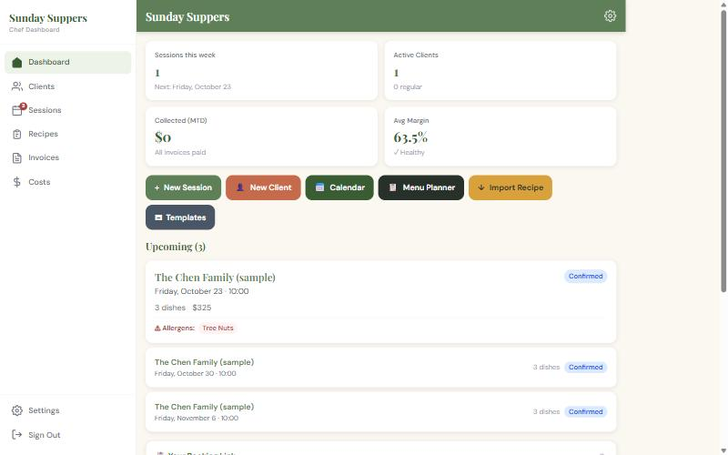
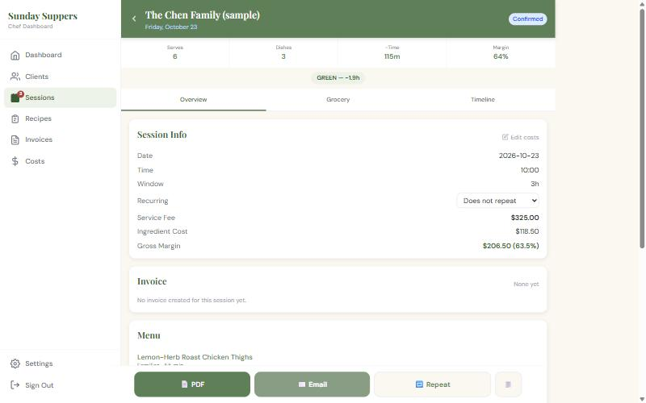
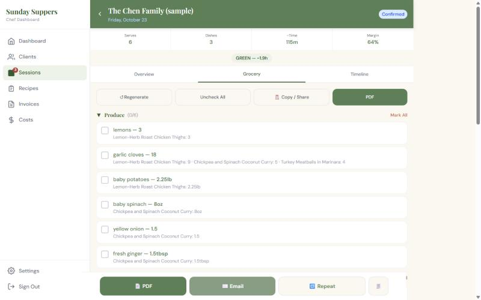
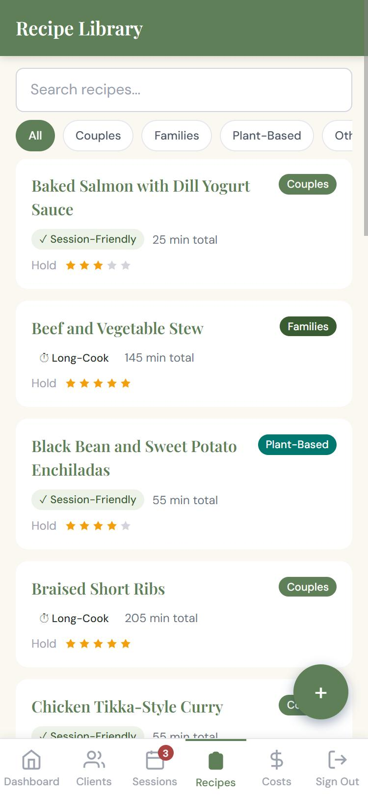

# Platebook

> **The kitchen office for home & personal chefs.** Clients, bookings, menus, grocery runs, meal-plan PDFs and invoices in one self-hosted app.
>
> Created by **[taliesin-fios](https://github.com/taliesin-fios)** · [PolyForm Shield 1.0.0](LICENSE): free to use and self-host, not for resale.

<p align="center">
  
  
</p>
<p align="center">
  
  
</p>

Platebook is for chefs who cook in clients' homes, run weekly meal prep, or cater dinner parties. Each chef gets:

- **Clients:** households with allergies, dietary styles, likes and dislikes, and kitchen notes.
- **A booking page:** your own link (`/book/<your-name>`) where new clients fill in an intake form and, optionally, pay a deposit (recorded by hand or taken through Stripe).
- **Sessions:** a calendar with conflict warnings, sessions that repeat every 1–4 weeks, menus checked against each client's allergies, and a feasibility check on cooking time.
- **Recipes:** a library that scales to each household's serving size. Import a recipe from a URL or pasted text (optional, uses the Claude API), or start from a 20-recipe starter library.
- **Grocery lists:** built from the menu and grouped by store section, ready to share, print or copy.
- **PDFs and email:** meal plans and invoices rendered on the server and emailed to the client under your business name.
- **Money:** invoices, ingredient costs, margins and profitability, plus CSV export.

One server can host one chef or many. Each account's data is private to it, enforced by Postgres row-level security.

## License

**Source-available under the [PolyForm Shield License 1.0.0](LICENSE).**

- ✅ Free to use, change and self-host, including to run your own paid chef business.
- ✅ Free to share copies and changes, with the license attached.
- ❌ You may not sell Platebook, or offer it (or a modified version) as a product or hosted service that competes with it.

This isn't an OSI "open source" license, because it restricts competing commercial use. If you want to use Platebook in a way the license doesn't cover, open an issue to ask.

**Credit.** Platebook was created by [taliesin-fios](https://github.com/taliesin-fios). Copies and forks must keep the license and the `Required Notice:` lines in [LICENSE](LICENSE) and [NOTICE](NOTICE); please keep the source-file headers and the in-app "Powered by Platebook" credit as well.

## Self-hosting

Docker Compose runs the app and its Postgres database together:

```bash
git clone https://github.com/taliesin-fios/platebook.git && cd platebook
cp .env.selfhost.example .env        # fill in the secrets
docker compose -f docker-compose.selfhost.yml up -d --build
```

Then put a reverse proxy with HTTPS in front of it. **[docs/SELF_HOSTING.md](docs/SELF_HOSTING.md)** covers HTTPS, email, Stripe, AI, backups, upgrades and who can sign up.

> **Allergen detection is advisory.** Platebook flags likely allergens by matching keywords in ingredient names. It isn't a certified check: always confirm allergies with the client.
>
> **You are responsible for your clients' data.** A self-hosted server holds names, addresses, allergies and payment records. Keep it patched and backed up.

---

## Development

Everything below is for working on Platebook itself. To just run it, see [Self-hosting](#self-hosting).

### Prerequisites

| Tool | Version |
|------|---------|
| Rust (cargo) | stable, 1.92+ (`rustup`; on Windows without Visual Studio use the GNU toolchain + `scoop install mingw`, see [`server-rs/README.md`](server-rs/README.md#running-locally)) |
| PostgreSQL | 14+ (18 locally), **or** Docker to run it in a container |
| Node.js | 20.19+ for the client (CI runs 20.x) |
| npm | 9.x |
| Git | any recent |

The API is the Rust server in [`server-rs/`](server-rs/) (Axum + SQLx on Postgres with Row-Level Security). It replaced the old Express + SQLite server, which has been removed; data from an old SQLite file moves over with [`tools/migrate-sqlite`](tools/migrate-sqlite/).

### Installation

```bash
# 1. Clone the repository
git clone https://github.com/taliesin-fios/platebook.git
cd platebook

# 2. Install the Node dependencies (root, client, HTTP tests, migration tool)
npm run install:all

# 3. Database + server-rs/.env, in one command
npm run db:setup
```

`npm run db:setup` ([`server-rs/scripts/db-setup.mjs`](server-rs/scripts/db-setup.mjs)):

- creates `server-rs/.env` from [`server-rs/.env.example`](server-rs/.env.example) if it's missing, with random `JWT_SECRET` / `INTAKE_SECRET`;
- if a Postgres server answers at that file's `DATABASE_URL` (default `postgres://postgres@localhost:5432/chef_dev`: a local install with `psql` on the PATH), creates the database if it doesn't exist;
- otherwise (or with `npm run db:setup -- --docker`) starts Postgres 18 from [`docker-compose.yml`](docker-compose.yml) on `127.0.0.1:5432` with the `chef_dev` database.

It never drops or changes existing data. The schema is applied by the server itself on start (pending migrations in `server-rs/migrations/` run automatically).

### Running in Development

```bash
# Rust API (port 3002) + Vite dev server (port 5174)
npm run dev
```

- **API** → `http://localhost:3002` (`npm run server`: `cargo run` in `server-rs/`)
- **App** → `http://localhost:5174` (`npm run client`: Vite with `/api` proxied to :3002; `API_PROXY_TARGET` overrides it)

In the Claude desktop app, use the `.claude/launch.json` entries "Platebook — API (Rust)" and "Platebook — Frontend (Vite)".

> **New accounts start empty.** The onboarding wizard offers each chef an optional starter recipe library and sample client.

### Building for Production

```bash
# Build the React app (client/dist) and the release binary
npm run build

# Run the release binary; it also serves client/dist at /
npm start
```

The deployable artifact is the Docker image ([`server-rs/Dockerfile`](server-rs/Dockerfile), build context = repository root). It holds the release binary and the React build, runs migrations on start and listens on `PORT` (default 3000).

```bash
docker build -f server-rs/Dockerfile -t chef-server .
docker run -p 3000:3000 -e DATABASE_URL=postgres://postgres@host.docker.internal:5432/chef_dev -e JWT_SECRET=... chef-server
```

### Environment Variables

All configuration lives in `server-rs/.env` (gitignored). The annotated template is [`server-rs/.env.example`](server-rs/.env.example). Names are the same as the old Express server's.

| Variable | Required | Description |
|----------|----------|-------------|
| `DATABASE_URL` | **Yes** | Postgres connection URL (the server runs migrations on start) |
| `JWT_SECRET` | **Yes** (prod) | Signs session JWTs and one-time sign-in / password-reset links |
| `INTAKE_SECRET` | **Yes** (prod) | Signs HMAC tokens for client intake edit links |
| `SIGNUP_MODE` | Optional | `open` (default) / `first` (only while no account exists) / `closed` |
| `NODE_ENV` | Optional | `production` hides internal error details and requires `JWT_SECRET` |
| `PORT` | Optional | API port (`3002` in `.env.example`; the Docker image uses `3000`) |
| `CLIENT_URL` | Optional | Frontend origin, used for CORS, emailed links and Stripe redirects |
| `TRUST_PROXY_HOPS` | Optional | Reverse proxies in front of the API that append to `X-Forwarded-For` (default `1`; `0` = clients connect directly and the header is ignored). Rate limits key on the client address this picks |
| `CLIENT_DIST` | Optional | Serve this React build at `/` (`npm start` and the Docker image set it) |
| `ANTHROPIC_API_KEY` | Optional | Enables AI recipe import + menu suggestions |
| `ANTHROPIC_MODEL` | Optional | Overrides the per-route Claude model defaults |
| `PAYMENTS_MODE` | Optional | `manual` (default) / `disabled` / `stripe` |
| `STRIPE_SECRET_KEY` | If Stripe | Stripe secret key |
| `STRIPE_WEBHOOK_SECRET` | If Stripe | Stripe webhook signing secret |
| `BOOKING_FEE_CENTS` | Optional | Stripe fallback deposit when a chef hasn't set one (default `5000`) |
| `EMAIL_HOST` | Optional | SMTP host (e.g. `smtp.hostinger.com`) |
| `EMAIL_PORT` | Optional | SMTP port (default `587`) |
| `EMAIL_USER` | Optional | SMTP login |
| `EMAIL_PASS` | Optional | SMTP password |
| `EMAIL_FROM` | Optional | From address for outgoing mail |
| `ALLOW_DEV_LINK` | Optional | `true` (dev only, no SMTP) returns magic/reset links in the API response |
| `AUTO_BACKUP` | Optional | `true` runs a daily `pg_dump` into `BACKUP_DIR` (at `AUTO_BACKUP_HOUR`) |
| `RUST_LOG` | Optional | Log filter (default `info,tower_http=info`) |

> When `EMAIL_HOST` is not set, emails are **logged** instead of sent, so you can develop without an SMTP server.

### Accounts & Onboarding

- **Sign up** at `/signup` (email + password, ≥ 10 chars) → a 5-step **onboarding wizard** at `/onboarding`: business details → services & defaults → booking & payment policy → optional starter recipe library / sample client → share your booking link.
- **Sign in** at `/login` with a password, or request a one-click magic link. **Forgot password** at `/forgot`.
- Every chef's data is private to their account: queries are scoped by `account_id`, and Postgres Row-Level Security enforces it.
- Each chef gets a public booking page at **`/book/<slug>`**.


### Lint

```bash
npm run lint       # client ESLint + cargo fmt --check + cargo clippy -D warnings
npm run lint:fix   # client ESLint --fix + cargo fmt
```

Type errors in the client are caught by `npm run typecheck` in `client/`, which `npm run build` also runs.

### Tests

```bash
npm test               # all four below
npm run test:client    # Vitest
npm run test:server    # cargo test in server-rs/ (a throwaway Postgres database per test)
npm run test:http      # tests/http: api.smoke, auth, tenancy against a freshly built server-rs
npm run test:migrate   # tools/migrate-sqlite: conversions + a legacy SQLite database migrated end to end
```

`test:server`, `test:http` and `test:migrate` need a Postgres user that may create databases (`DATABASE_URL` / `PARITY_ADMIN_DATABASE_URL`, default `postgres://postgres@localhost:5432/postgres`) and `psql` on the PATH. Cross-account isolation is covered by `server-rs/tests/tenancy.rs` and `rls.rs` and by the HTTP `tenancy` suite. CI runs everything on every push.

**Manual verification checklist** (see [`ARCHITECTURE.md`](ARCHITECTURE.md#verification-checklist) for full steps):

1. Error leakage — trigger a bad request with `NODE_ENV=production`; the response should say `"Internal server error"`, not a SQL message.
2. Invoice terminal-state guard — PATCH a `paid` invoice status → expect `409`.
3. Session idempotency — POST `/api/sessions/:id/complete` twice → second call returns `409`.
4. Fetch resilience — stop the API; the React app should show error states, not blank pages.
5. Safe-area rendering — open on an iPhone with notch; bottom action bars should clear the home indicator.

### Moving data from the old SQLite database

[`tools/migrate-sqlite`](tools/migrate-sqlite/) copies a legacy SQLite file (the old Express server's `chef_app.db`) into a server-rs database in one verified transaction (ids kept, per-account row counts checked). The production data still sits in SQLite and moves over at cutover. Options and exit codes: [`tools/migrate-sqlite/README.md`](tools/migrate-sqlite/README.md).

```bash
cd tools/migrate-sqlite
node migrate-to-postgres.js --sqlite <copy-of-chef_app.db> --database-url postgres://postgres@localhost:5432/<empty migrated db> --dry-run
```

### Deploying

See [`server-rs/README.md`](server-rs/README.md#deploying): the Docker image, platforms such as Railway (root [`railway.json`](railway.json)), and moving data from the old SQLite server.

### Project Structure

```
platebook/
├── client/                    # React + TypeScript + Vite + Tailwind SPA
│   └── src/
│       ├── pages/             # one file per route (Dashboard, Sessions, …)
│       ├── components/        # shared UI components
│       ├── hooks/             # useApi (typed fetch), useSignupOpen
│       ├── utils/             # serverPdf, dateUtils, quantityScale
│       ├── types/             # API response types (generated from the Rust structs)
│       └── constants.ts       # APP_NAME, allergen keywords, status maps
├── server-rs/                 # Rust API (Axum + SQLx, Postgres + RLS); see server-rs/README.md
│   ├── src/                   # app.rs (router), routes/, auth.rs, db.rs (tenant tx), pdf/ (Typst), seed/
│   ├── migrations/            # SQL migrations, applied on start
│   ├── tests/                 # cargo integration tests (HTTP, RLS, tenancy)
│   └── Dockerfile             # one image: release binary + React build
├── tests/http/                # black-box HTTP suites against server-rs
├── scripts/license-headers.mjs # checks (and --fix adds) the copyright header on every source file
├── tools/migrate-sqlite/      # one-time import from the legacy Express + SQLite server
├── docs/SELF_HOSTING.md       # self-hosting guide
├── docker-compose.selfhost.yml # app + Postgres for self-hosting
├── docker-compose.yml         # local Postgres for development (npm run db:setup)
└── railway.json               # optional: deploy the Docker image on Railway
```

---

## Documentation

- [`docs/SELF_HOSTING.md`](docs/SELF_HOSTING.md): running your own server
- [`MANUAL.md`](MANUAL.md): the user guide, page by page
- [`ARCHITECTURE.md`](ARCHITECTURE.md): data flow, auth and tenancy model, public routes
- [`server-rs/README.md`](server-rs/README.md): the Rust server (tests, row-level security, PDFs, deploying)
- [`STYLE_GUIDE.md`](STYLE_GUIDE.md): UI and branding conventions
- [`ROADMAP.md`](ROADMAP.md) and [`CHANGELOG.md`](CHANGELOG.md)

## Contributing

Issues and pull requests are welcome. See [CONTRIBUTING.md](CONTRIBUTING.md) and the [Code of Conduct](CODE_OF_CONDUCT.md). Report security problems privately, as described in [SECURITY.md](SECURITY.md).
